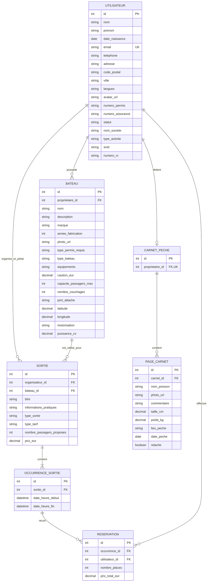

# Fisher Fans — Devoir 1 : rendu des 4 premières tâches (version 2)

**Date :** 20 novembre 2026  
**Équipe :** Benoit, Max et le troisième membre (toi)  
**Référence :** Cahier des charges Fisher Fans, Laurent Pastorelli, 23 pages.  
**Dépôt de groupe choisi :** [benoit-bremaud/fisher-fans-api](https://github.com/benoit-bremaud/fisher-fans-api) — accès en écriture en attente.

**Précision suite à l'échange oral :** respecter le CDC strictement : permis requis pour enregistrer **tout** bateau (BF27) ; sortie seulement avec bateau enregistré possédé par l'organisateur (BF26) ; **propriétaire = organisateur = capitaine** ; une capacité totale à bord plafonnée à 12 personnes (capitaine compris), selon la convention de l'équipe. Les décisions ci-dessus ne sont plus proposées à la réinterprétation.

---

## 1. Identification des tâches à réaliser

**Méthode :** respecter BF1–BF27, BN1–BN8 et les annexes sans modifier les règles de permis, de propriété ou d'organisation actées par le groupe. La création d'une sortie nécessite un bateau possédé par l'organisateur (BF26) ; la création du bateau requiert un permis renseigné (BF27).

| Axe | Travaux | Exigences CDC | Dépendances |
|---|---|---|---|
| T01 — Analyse et décisions | Lire le CDC ; recenser BF/BN ; consigner règles fixes et ambiguïtés restantes ; questions au professeur | Tous | Aucune |
| T02 — Modèle des ressources | Diagramme ER/MCD, cardinalités, attributs, clés et contrôle `organisateur_id = proprietaire_id` | BF2, BF26–BF27, annexes 1–5 | T01 |
| T03 — Dépôt et socle API | Dépôt GitHub commun de Benoit, branches/PR ; Laravel, base SQL, API `/api/v1`, JSON, HTTPS local, OpenAPI 3.1, CI | BN1–BN5, livrables | Accès au dépôt ; T01 |
| T04 — Utilisateurs et accès | Inscription, authentification, profil, édition, suppression/anonymisation, filtrage | BF1, BF3, BF8, BF13, BF19–BF20, BN6 | T02–T03 |
| T05 — Bateaux | CRUD, annexes 2, possession, numéro de permis obligatoire **pour tout bateau**, capacité passagers 0–11, recherche par localisation | BF4, BF9, BF14, BF19, BF21, BF24, BF27 | T04 |
| T06 — Sorties | CRUD, vérification bateau enregistré et appartenant au créateur, capitaine = propriétaire = organisateur, dates/récurrence | BF5, BF10, BF15, BF22, BF26, annexe 3 | T05 |
| T07 — Réservations | Création, modification, suppression ; prix et places ; contrôle des places disponibles et concurrence | BF6, BF11, BF17, BF23, annexe 4 | T06 |
| T08 — Carnets de pêche | Créer le carnet ; pages/captures, édition, suppression, liste et contrôle du propriétaire | BF7, BF12, BF16, BF18–BF19, annexe 5 | T04 |
| T09 — Recherches et erreurs | Filtres combinables sur utilisateurs/bateaux/sorties/réservations ; bounding box ; erreurs métier | BF19–BF25 | T04–T08 |
| T10 — Qualité et livraison | Tests, sécurité, RGPD, performances, documentation API, OpenAPI 3.1, scénarios recette et soutenance | BN3–BN8, livrables | Transversal |

**Chemin critique :** socle/comptes → bateaux → sorties → réservations. Les carnets, tests et la documentation peuvent progresser en parallèle.

---

## 2. Répartition des tâches

**Statut :** proposition équilibrée à confirmer entre les trois membres selon leurs compétences et disponibilités. L'équipe utilisera le **dépôt public existant de Benoit**, `benoit-bremaud/fisher-fans-api`, une fois les invitations de collaboration acceptées. Aucun accès en écriture ni dépôt parallèle n'est présumé.

| Membre | Pour le devoir du 20/11/2026 | Développement principal prévu | Relecture par un autre membre |
|---|---|---|---|
| **Benoit** | Contrôler utilisateurs/bateaux dans le MCD et relever exigences des annexes 1–2 ; documenter BF27 sans exception et plafond de capacité | Socle Laravel, comptes/authentification, bateaux et permissions | Max relit le module bateaux ; tu vérifies les règles de capacité |
| **Max** | Contrôler sorties/récurrence et annexe 3 ; vérifier la règle propriétaire = organisateur = capitaine ; revoir les cardinalités | Sorties, occurrences et carnets de pêche | tu relis sorties/récurrence ; Benoit relit carnet |
| **Toi** | Assembler les 4 documents ; maintenir diagramme Mermaid ; traiter réservations/annexe 4, questions et rendu | Réservations, filtres géographiques, intégration, OpenAPI/documentation/recette | Benoit relit réservations ; Max relit MCD |

**Travail commun :** relire les cardinalités, contrôler les règles BF26/BF27 et les 12 personnes à bord, relire les questions, rendre le document.

---

## 3. Diagramme de relation entre les ressources

**Éditeur :** [Mermaid Live — diagramme modifiable](https://mermaid.live/edit#pako:eNqdVttu2zAM_RXDz-0P5C3LvK3Y0Ba57GmAwMhMIsyWVIoKWqT999Gx08aRvXbzQxCLpESdQx76kGtXYj7JkT4b2BLUv2wmz2p58-NmMV0Wq3n2_Hx97Q7ZJ3mbrrJJ5l0IWOKo4-JuvrwpxNHRFqwJqJCVN5XjLqbb6dIdA6vIpmoivIvUOnfmxvn5kN3NZqv5vLidFeo1TjvLBi23_qlHd868WBTzn9Plzd2tBBFqZ3j0Dn1n3GxQcxy78nM2m85vi6W6L2bfmoxKPEuoZ-u2v59-LVRr6F0gPeDQLjWPsZyZMrv__rYUmIzdZtbVyZon7C2XwHj8URZMCGA1JjFYg6myVXoAY4V-52waAiWhlEOy3pSVsBgYqsS2N1WVRlRgtxFDesIeGEhFSjeysUZyyiPVJoxZIYRIg9eV5DjyEJoqOG2Q0xB-8qhAs9mbAWswhDyWB-nW8tJrgr_z2yx5cp4kGZDNldi_fIz_EoMm49k4m9hqoIeI_WPAWkS1gTUZDYNRUgDsBnk4otKyoAgf4gAZR5e1lB_EtOwkwmMtHXAWV6I2NVSZhthko_AkCKeENXjQwoLywjBskYKq4bHvI8CsBTXtot6JS5qWd8QKmEHvMD27EiA4lkMWZ7cXphO2AhKZcAHhKc7HrveU3vfKodOq98uhE1VBMtJlOTT2FuORQpHrUJqysRtH9THjoDzJn4ehRjxSGAQwM9IX0qZmM0jAG0VNNbuAA0RLkT--sfwypubvI9SmeIlAI31s6k4Dd3IQqhLX5_0_5LIxtpfQ-WD4AFlaRxIh1jhEVTvsRpk8YVeBHsWLnQhsglpv5PyPwlydZkC34fm8en8_DWRl5I9qlcwF6YJ_Uhjt6kYfmgxTJGRZBorS9QBIzpRB_d6m08ZgFMnqt_3riLwwrJ2rEKx8NFRvQiHQ5Fe5SLsMzTKfHHLeiYbJp1SJG4gV5y9XuWiXWzxZnU-YIl7l0Tfbd19a7eLLH_jc9mI)  
**Source :** `docs/03-diagramme-ressources.mmd`

**Invariant à contrôler :** `SORTIE.organisateur_id == BATEAU.proprietaire_id`. C'est aussi le capitaine, sans entité séparée. **BF27 :** permis renseigné au profil pour tout bateau. **Capacité :** max 12 personnes à bord, dont 1 capitaine, donc max 11 places passagers et jamais plus que la capacité réelle. `OCCURRENCE_SORTIE` est une **hypothèse technique** utile pour relier dates récurrentes et réservations, non une nouvelle exigence du professeur.

---

## 4. Liste des questions à poser

| Priorité | ID | Référence | Question |
|---|---|---|---|
| P0 | Q01 | Présentation p. 10, BF2–BF27 | La **location d'un bateau entier** mentionnée dans la présentation est-elle attendue en recette, alors qu'aucun BF ne définit la réservation d'un bateau entier ? |
| P0 | Q02 | Annexe 3 et annexe 4 | Pour les sorties récurrentes, une réservation doit-elle viser une **occurrence datée précise** ? Quelle est la règle de répétition d'une sortie (jours, dates, fréquence) ? |
| P0 | Q03 | Annexe 3 et annexe 4 | Comment calculer le **prix total** d'une réservation si la sortie utilise un tarif **global** au lieu d'un prix par personne ? |
| P0 | Q04 | BF8–BF11, BN6 | Que deviennent les sorties/réservations lorsqu'on supprime **un utilisateur, son bateau ou une sortie** ? Quels champs sont anonymisés/conservés ? |
| P0 | Q05 | BF1, BF8–BF23 | Quels utilisateurs peuvent **lire, modifier ou supprimer** les profils, bateaux, sorties, réservations et pages des carnets ? |
| P0 | Q06 | BF6, BF17 | Un **organisateur peut-il réserver sa propre sortie** ? Un même utilisateur peut-il effectuer plusieurs réservations sur une même occurrence ? |
| P0 | Q07 | BF15, BF17, annexe 3 | Comment gérer la **modification d'une sortie déjà réservée** (date, bateau, prix, places) et les annulations de réservations ? |
| P1 | Q08 | BF7, BF12, BF16, BF18, annexe 5 | Le carnet est-il créé à la demande ou automatiquement, et comment **créer une nouvelle page** si aucun BF ne demande explicitement cette opération ? |
| P1 | Q09 | BF16 et BF18 | BF16 et BF18 correspondent-ils à **la même modification de page**, BF18 ne faisant que préciser l'utilisateur ? |
| P1 | Q10 | BF5, BF15, annexe 3 | Un même bateau peut-il être affecté à **deux sorties aux horaires qui se chevauchent** ? |
| P1 | Q11 | BF20–BF23 | Les filtres doivent-ils accepter **toutes** les caractéristiques de chaque ressource, y compris les informations personnelles, ou seulement un sous-ensemble publiable ? |
| P1 | Q12 | Annexe 1 | Les comptes **professionnels** ont-ils des permissions spécifiques, ou seulement des champs supplémentaires de profil ? |
| P1 | Q13 | BF24 et annexe 2 | La recherche par **bounding box** porte-t-elle bien sur le **port d'attache** et comment traiter une boîte traversant la longitude ±180° ? |
| P1 | Q14 | BF25 | Quel format de **codes d'erreurs métier** est attendu au-delà du statut HTTP (par exemple `PERMIS_REQUIS`, `BATEAU_REQUIS`) ? |
| P1 | Q15 | BN7–BN8 | Quels critères **mesurables** de performance et de montée en charge seront utilisés pour évaluer ces deux exigences ? |
| P1 | Q16 | BF1, BF3 | L'inscription est-elle accessible sans identification préalable bien que le reste de l'API soit privé ? |
| P1 | Q17 | Annexes 1–5 | Quels champs sont obligatoires ou facultatifs, et quels contrôles précis de format/unicité sont attendus **au-delà des formats indiqués** dans les annexes ? |
| P1 | Q18 | Modalités p. 5–7 | Quelles sont les **dates des quatre devoirs Moodle** et où consulter le plan de présentation disponible sur Moodle ? |

**Questions déjà réglées et retirées :** permis exigé pour tous les bateaux, possession obligatoire d'un bateau enregistré, propriétaire = organisateur = capitaine, plafond total de 12 personnes dont 1 capitaine. Le tableau complet des décisions figure dans `docs/05-regles-retenues.md`.

---

## État de livraison du devoir

- Quatre éléments rédigés ; diagramme éditable dans Mermaid Live.
- Le groupe doit relire, confirmer l'affectation interne et déposer les fichiers dans son **unique dépôt** après obtention des droits d'écriture.
- Aucune modification du dépôt distant n'a été effectuée depuis ce pack.
