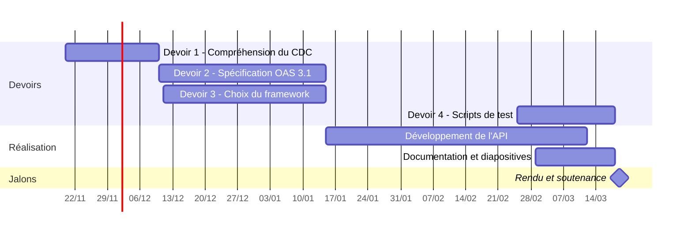

# Fisher Fans API

API réseau de l'application mobile fictive « Fisher Fans » (partage de sorties de pêche en mer, location de bateaux, carnet de pêche), réalisée pour le projet de groupe du cours Web services (Ynov M2, 2026-2027).

## Équipe

- Benoît Bremaud ([@benoit-bremaud](https://github.com/benoit-bremaud))
- Clément ([@yazii](https://github.com/yazii))

## Livrables

- Code source et tests de l'API (ce dépôt)
- Spécification de l'API en OpenAPI Specification (OAS) 3.1
- Documentation de l'API
- PDF de la soutenance

## Planning

Rendu et soutenance le 2027-03-19 ; seul le dernier commit avant cette date compte.

