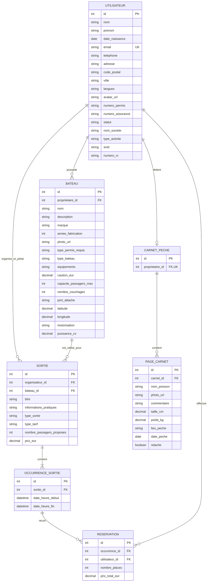

# Fisher Fans — Devoir 1 : diagramme de relation des ressources (version 2)

**Source modifiable :** `03-diagramme-ressources.mmd`  
**Éditeur :** [ouvrir le MCD dans Mermaid Live](https://mermaid.live/edit#pako:eNqdVttu2zAM_RXDz-0P5C3LvK3Y0Ba57GmAwMhMIsyWVIoKWqT999Gx08aRvXbzQxCLpESdQx76kGtXYj7JkT4b2BLUv2wmz2p58-NmMV0Wq3n2_Hx97Q7ZJ3mbrrJJ5l0IWOKo4-JuvrwpxNHRFqwJqJCVN5XjLqbb6dIdA6vIpmoivIvUOnfmxvn5kN3NZqv5vLidFeo1TjvLBi23_qlHd868WBTzn9Plzd2tBBFqZ3j0Dn1n3GxQcxy78nM2m85vi6W6L2bfmoxKPEuoZ-u2v59-LVRr6F0gPeDQLjWPsZyZMrv__rYUmIzdZtbVyZon7C2XwHj8URZMCGA1JjFYg6myVXoAY4V-52waAiWhlEOy3pSVsBgYqsS2N1WVRlRgtxFDesIeGEhFSjeysUZyyiPVJoxZIYRIg9eV5DjyEJoqOG2Q0xB-8qhAs9mbAWswhDyWB-nW8tJrgr_z2yx5cp4kGZDNldi_fIz_EoMm49k4m9hqoIeI_WPAWkS1gTUZDYNRUgDsBnk4otKyoAgf4gAZR5e1lB_EtOwkwmMtHXAWV6I2NVSZhthko_AkCKeENXjQwoLywjBskYKq4bHvI8CsBTXtot6JS5qWd8QKmEHvMD27EiA4lkMWZ7cXphO2AhKZcAHhKc7HrveU3vfKodOq98uhE1VBMtJlOTT2FuORQpHrUJqysRtH9THjoDzJn4ehRjxSGAQwM9IX0qZmM0jAG0VNNbuAA0RLkT--sfwypubvI9SmeIlAI31s6k4Dd3IQqhLX5_0_5LIxtpfQ-WD4AFlaRxIh1jhEVTvsRpk8YVeBHsWLnQhsglpv5PyPwlydZkC34fm8en8_DWRl5I9qlcwF6YJ_Uhjt6kYfmgxTJGRZBorS9QBIzpRB_d6m08ZgFMnqt_3riLwwrJ2rEKx8NFRvQiHQ5Fe5SLsMzTKfHHLeiYbJp1SJG4gV5y9XuWiXWzxZnU-YIl7l0Tfbd19a7eLLH_jc9mI)  
**Nature du dessin :** diagramme entités–associations Mermaid (ERD), représentant les ressources du CDC ; il ne s'agit pas d'une notation Merise strictement formelle.

## Diagramme

## Entités et cardinalités

| Association | Cardinalité | Justification |
|---|---|---|
| UTILISATEUR — BATEAU | Utilisateur 0..N bateaux ; chaque bateau 1 propriétaire | Annexe 1 / annexe 2 |
| UTILISATEUR — SORTIE | Utilisateur 0..N sorties ; chaque sortie 1 organisateur | Annexe 3 |
| BATEAU — SORTIE | Bateau 0..N sorties ; chaque sortie 1 bateau | Annexe 3 / BF26 |
| SORTIE — OCCURRENCE_SORTIE | Sortie 1..N créneaux ; chaque créneau 1 sortie | **Hypothèse technique** pour les listes de dates/heures de l'annexe 3 |
| OCCURRENCE_SORTIE — RESERVATION | Créneau 0..N réservations ; chaque réservation 1 créneau | **Hypothèse technique** pour la « date retenue » de l'annexe 4 |
| UTILISATEUR — RESERVATION | Utilisateur 0..N réservations ; réservation 1 demandeur | Annexe 4 |
| UTILISATEUR — CARNET_PECHE | Utilisateur 0..1 carnet ; carnet 1 propriétaire | BF7 / annexe 1 ; cardinalité 0..1 proposée |
| CARNET_PECHE — PAGE_CARNET | Carnet 0..N pages ; chaque page 1 carnet | Annexe 5 |

## Les trois invariants à ne pas confondre

**R01 – BF27 : permis pour enregistrer un bateau.** Aucun utilisateur ne peut enregistrer un bateau tant qu'il n'a pas renseigné son numéro de permis dans son profil. La règle est **sans exception selon le type de bateau**. Le MCD représente ce numéro sur UTILISATEUR, sans entité PERMIS distincte.

**R02 – BF26 : bateau pour créer une sortie.** Toute SORTIE possède `bateau_id` correspondant à un bateau enregistré appartenant au créateur de la sortie. On refuse la sortie si l'utilisateur ne possède aucun bateau.

**R03 – identité des rôles.** L'utilisateur qui **possède le bateau** est **le même** que celui qui **organise** et **capitaine** la sortie : `SORTIE.organisateur_id = BATEAU.proprietaire_id`. Le capitaine n'est pas un deuxième participant/profil ni un conducteur tiers. Cette égalité doit être contrôlée à chaque création ou modification de sortie. Les deux relations visibles dans le diagramme ne donnent pas deux libertés de choix.

## Capacité et réservations

L'annexe 2 décrit une « capacité maximum (en nombre de passagers) ». La règle de projet de l'équipe fixe au plus **12 personnes au total à bord** (capitaine compris). On stocke donc `capacite_passagers_max` (hors capitaine), avec **0 ≤ capacité ≤ 11**. La capacité totale = `1 + capacite_passagers_max`. La valeur réelle du bateau peut être inférieure à 12 ; il ne faut pas remplacer systématiquement sa capacité par 12.

La SORTIE précise `nombre_passagers_proposes`, qui doit être ≤ `capacite_passagers_max`. Une réservation consomme uniquement des places passagers, jamais la place du capitaine. Les réservations visant la même occurrence ne doivent pas dépasser `nombre_passagers_proposes` : la politique d'annulation/statut reste à décider.

## Correspondance avec les annexes

- **Annexe 1 (pages 17–18)** : utilisateur (identité/contact, langues, permis 8 chiffres, assurance 12 caractères, particulier/professionnel, société et immatriculation). Collections de bateaux, sorties et réservations représentées par les relations ; non dupliquées dans des colonnes.
- **Annexe 2 (pages 19–20)** : bateau (description, marque, permis requis, type, équipements, caution, capacité passagers, couchages, port et coordonnées, moteur, puissance en CV).
- **Annexe 3 (page 21)** : sortie (titre, informations, type, tarif, prix, passagers proposés, organisateur, bateau). Dates et horaires regroupés au sein d'occurrences, proposition à valider.
- **Annexe 4 (page 22)** : réservation (créneau de la sortie, nombre de places, prix total, utilisateur). Le lien à l'occurrence permet de retrouver la sortie et la date choisie.
- **Annexe 5 (page 23)** : page de carnet (poisson, photo, commentaire, longueur, poids, lieu, date, relâché). Le carnet relie l'utilisateur à ses pages.

## Ce qui est fixé / encore ouvert

| Fixé pour ce devoir | Encore ouvert / hypothèse |
|---|---|
| Permis renseigné obligatoire pour **tout** bateau (BF27) | Vérification externe/validité du permis non demandée explicitement |
| La sortie nécessite le **bateau enregistré de l'organisateur** (BF26 et choix du groupe) | Fonctionnement exact des sorties récurrentes |
| Propriétaire = organisateur = capitaine | Tarif global / modification / annulation des réservations |
| Au plus 12 personnes à bord, dont 1 capitaine | Sort d'une réservation si bateau/sortie/compte supprimé |
| Pas de conducteur tiers ni de délégation | La location de bateaux entiers annoncée en introduction |

**Point de vigilance :** `ORGANISATEUR_ID` est conservé sur SORTIE car l'annexe 3 exige l'utilisateur à l'origine de la sortie. C'est volontairement une donnée redondante par rapport à `BATEAU.proprietaire_id` : une règle d'intégrité devra empêcher leur divergence. Une solution alternative serait de dériver l'organisateur du propriétaire du bateau, mais cela doit être un choix technique explicite.
